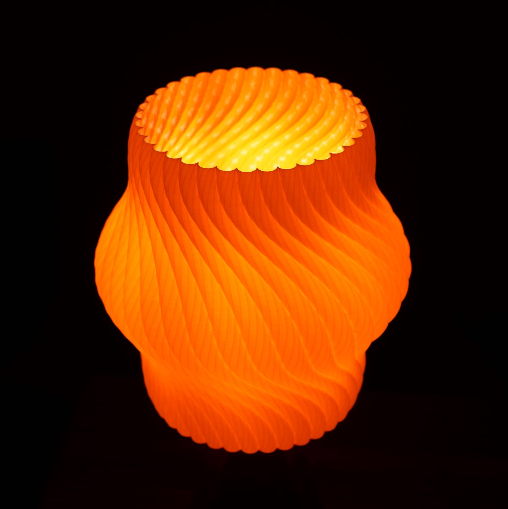
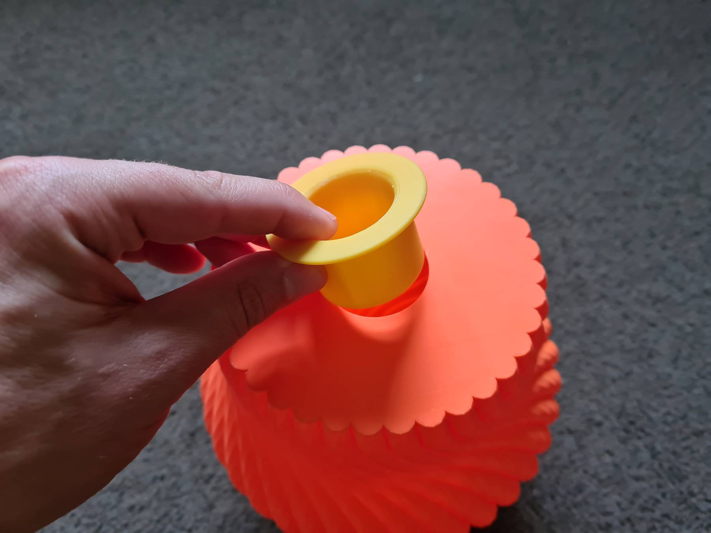

# lampshades

3D-printable lampshades in OpenSCAD, printed in vase mode and lit from inside. Most are Matthew Seabright's, with
their mounting parts; two more come from other designers. Each design is a module you can resize, and the
[examples](examples/) show every one in 3D.

## The designs

| Designs | By | Licence |
|---|---|---|
| Shades: double rotated octagon and pentagon, fish tail, golfball, pineapple, rope swirl, rotated star, screw compressor, triple spring, turbine, noise. Mounting: adaptor, base, feet. Photos. | [Matthew Seabright](https://github.com/mjseabright/lampshades) | [MIT](LICENSE) |
| [Gyro lamp shade](gyro-shade/) | Harald Andersson | [CC BY-NC-SA 4.0](gyro-shade/LICENSE) |
| [Lamp shade generator](shade-generator/) | seasick | [CC BY 4.0](shade-generator/LICENSE) |

Matthew Seabright's designs are taken from
[mjseabright/lampshades](https://github.com/mjseabright/lampshades) at commit
[`5c20d70`](https://github.com/mjseabright/lampshades/tree/5c20d70) (2026-08-31), unchanged. That repo is where they
are developed, and their STLs are on [Printables](https://www.printables.com/social/308094-mjseabright/collections/207685).

## Make one

Each shade lives in its own folder. `<design>.scad` holds the shape as a module, and the files beside it, such as
`turbine/turbine_small.scad`, set the dimensions and add the hole for the mount. Open one of those in OpenSCAD to
render a shade. `geometry_functions.scad` and `mounting_functions.scad` hold the shapes the designs share.

Rendering stacks one thin slice per layer, so a fine `layer_height` is slow. Raise it while you try out a shape and
set it back to 0.2 mm for the final render.

The noise shade is generated: `noise/noisey_generator.py` writes `noise/noisey.scad`, and the parameters are at the
top of the script.

The gyro shade and the generator are single files with Customizer parameters.

## Mounting and printing

The shades fit a lamp base with an E14 bulb and the usual ~28 mm threaded shade ring. Print the shade in vase mode
(one wall, spiral), and print the [adaptor](adaptor/adaptor.scad) normally, with supports, then glue it into the
bottom of the shade. `bases/` and `feet/` hold a low-profile stand for the larger shades.

Settings that work for vase-mode shades: PETG (PLA can warp near a hot bulb or in sunlight), 0.2 mm layers, 0.6 mm
line width, 6 solid bottom layers. Fuzzy skin suits several of the designs.

More pictures are in [`photos/`](photos/). The story of designing and selling these is on Matthew Seabright's
[blog](https://tartartech.xyz/lampshade-adventures).

## Licence

Each design keeps its designer's licence, as the table above gives it. The README, the examples and the build are
MIT, under [LICENSE](LICENSE).
